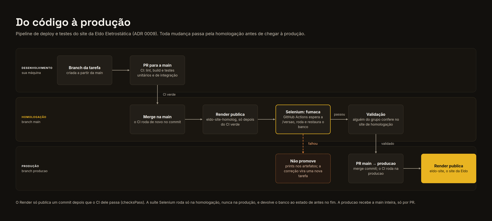

# Pipeline de deploy e testes

Toda mudança passa pela homologação antes de chegar à produção ([ADR 0009](../adr/0009-homologacao-antes-da-producao.md)). A `main` é publicada na homologação e a `producao` na produção.

## Passo a passo

1. **Branch da tarefa.** Criada a partir da `main`.
2. **PR para a `main`.** O CI roda o lint, o build e os testes. O merge só acontece com o CI verde.
3. **Merge na `main`.** O CI roda de novo no commit da `main`.
4. **Render publica a homologação.** O `eldo-site-homolog` e a `eldo-api-homolog` só publicam o commit depois que o CI dele passa.
5. **Selenium (fumaça).** O GitHub Actions espera a rota `/versao` do site devolver o commit novo e roda o fluxo `fumaca` na homologação. No fim, o banco volta ao estado de antes ([Testes de ponta a ponta](../testes/index.md)).
6. **Validação.** Alguém do grupo confere a mudança no site da homologação. Se o Selenium falhou, a mudança não é promovida: os prints ficam nos artefatos da execução, e a correção vira uma nova tarefa.
7. **PR `main` → `producao`.** O PR de promoção leva a `main` inteira, com merge commit. Nenhum PR de tarefa vai direto para a `producao`.
8. **Render publica a produção.** O `eldo-site` e a `eldo-api` publicam a `producao` depois que o CI passa.

Os planos, os custos e as peças de cada ambiente estão em [Hospedagem e custos](hospedagem-e-custos.md).
