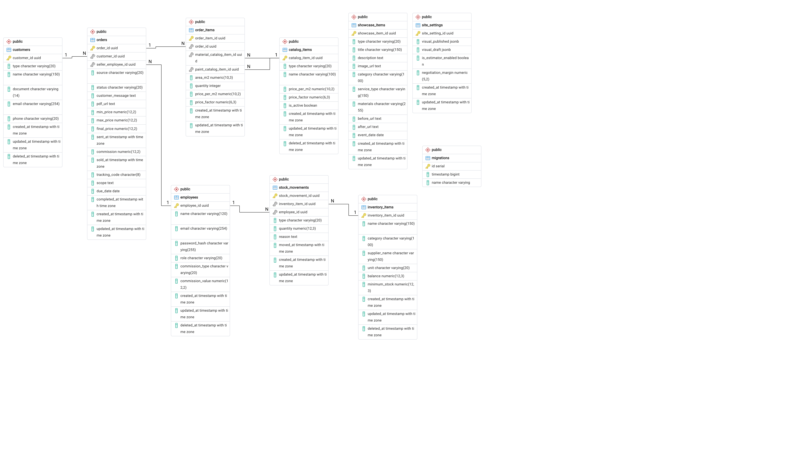

# Modelo de dados

O banco do Backend (PostgreSQL 16) tem 9 tabelas de domínio. A imagem abaixo é o modelo físico, gerado pelo ERD do pgAdmin a partir do banco que as migrations criam.

Clique na imagem para abrir em tamanho original.

| Tabela | O que guarda |
| --- | --- |
| `employees` | Funcionários, com nível de acesso e regra de comissão |
| `customers` | Clientes PF e PJ |
| `orders` | Pedido: contato, orçamento, venda e OS no mesmo registro, avançando pelo status |
| `order_items` | Peças do pedido, com os preços copiados do catálogo no cálculo |
| `catalog_items` | Catálogo de preços: tipos de pintura e materiais de peça |
| `inventory_items` | Itens de estoque, com saldo e estoque mínimo |
| `stock_movements` | Entradas e saídas de estoque |
| `showcase_items` | Vitrine do site: projetos do portfólio e eventos |
| `site_settings` | Configuração do site (registro único): identidade visual publicada e rascunho, e o simulador de orçamento |

A tabela `migrations`, que aparece na imagem, é do TypeORM: registra quais migrations já rodaram e não faz parte do domínio.

As decisões por trás do modelo estão nas ADRs do repositório, em especial a [ADR 0005](adr/0005-modelo-enxuto-de-nove-tabelas.md) (modelo de 9 tabelas) e a [ADR 0003](adr/0003-precos-e-comissoes-congelados.md) (preços e comissões congelados).
